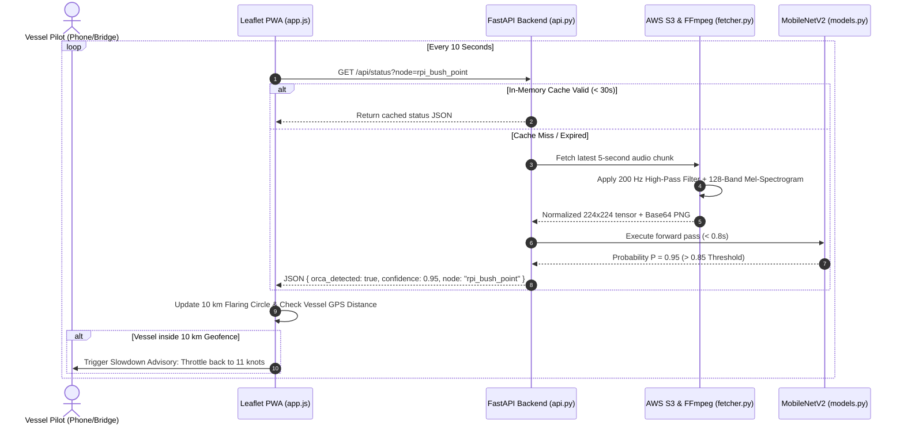

# OrcaSafe (SilenceOfSound) — Architecture & Technical Guide

OrcaSafe is a real-time, AI-driven bioacoustic detection and dynamic maritime slowdown alert platform. It is engineered for the people who can act immediately on the water: **commercial vessel pilots, ferry captains, and recreational boaters** across the Puget Sound and Salish Sea.

Rather than relying on static, seasonal slowdown bans that cost shipping companies valuable transit time even when no whales are present, OrcaSafe operates like a **dynamic "school-zone light" on the water**—triggering localized slowdown advisories only when endangered killer whales are actively detected.

---

## 1. Ecological Context & Conservation Science

The Southern Resident Killer Whale (SRKW) population has declined by **24%** from a 1995 peak of 98 individuals to just **74 whales today**. While scarce Chinook salmon prey and toxin bioaccumulation are major stressors, acoustic masking from commercial shipping represents an acute, continuous threat:

- **Echolocation Masking**: Commercial vessel traffic generates continuous low-frequency noise ($100\text{–}1000\text{ Hz}$) that masks the echolocation clicks and whistles orcas rely on to hunt and coordinate.
- **Foraging Degradation**: Studies demonstrate that **every $1\text{ dB}$ increase in vessel noise cuts an orca's odds of catching prey by $12.5\%$**.
- **The Slowdown Effect**: Slowing commercial container and cargo ships from **$18\text{ knots}$ to $11\text{ knots}$ reduces underwater acoustic sound energy by roughly $90\%$** ($\sim 10\text{ dB}$ sound energy cut), restoring $35\text{–}45\%$ of their foraging listening space.

---

## 2. High-Level System Architecture

```mermaid
flowchart TD
    subgraph Data_Ingestion["1. Live Acoustic Ingestion (Every 10s)"]
        A[8 Salish Sea Hydrophone Nodes\nOrcasound AWS S3 Network] -->|HLS Live Stream| B[QuiltS3Fetcher\ncore/fetcher.py]
        B -->|MPEG-TS 5-Second Slices| C[FFmpeg Subprocess Decoder]
    end

    subgraph Signal_Processing["2. Digital Signal Processing (DSP)"]
        C -->|PCM Audio 44.1 kHz| D[200 Hz High-Pass Butterworth Filter\nScipy sosfiltfilt]
        D -->|Pre-emphasis 0.97| E[128-Band Mel-Spectrogram Generator\nLibrosa & Magma Colormap]
        E -->|224x224 Normalized Matrix| F[Input Image Tensor]
    end

    subgraph ML_Inference["3. Low-Latency Neural Classification (< 0.8s)"]
        F --> G[MobileNetV2 Transfer Learning Backbone\n9.8 MB Checkpoint | core/models.py]
        G -->|Output Probability P| H{Detection Threshold\nP > 0.85?}
    end

    subgraph Dynamic_Geofencing["4. Dynamic Geofencing & Alert Dispatch"]
        H -->|Orca Confirmed| I[10 km Dynamic Slowdown Zone\nTriggered around Hydrophone]
        I --> J[FastAPI Cloud Run Backend\n1 vCPU / 2 GB RAM | Code/api.py]
    end

    subgraph Client_Interface["5. Interactive PWA Interface"]
        J -->|JSON Payload + Base64 Spectrogram| K[Interactive Leaflet.js PWA\nMobile & Desktop | Code/static/]
        K --> L[HTML5 Vessel Geolocation & Distance Tracking]
        L --> M[Vessel Slowdown Alert to 11 Knots\nAudio Playback & Spectrogram Inspection]
    end
```

---

## 3. Directory Layout & Source Code Map

```
SilenceOfSound/
├── Code/                          # Production Web Application & API Gateway
│   ├── api.py                     # FastAPI REST API, background worker pool, & 30s cache
│   ├── requirements.txt           # Pinned production dependencies (FastAPI, PyTorch, Librosa)
│   └── static/                    # Frontend Progressive Web App (PWA) client
│       ├── app.js                 # Leaflet.js map, HTML5 Geolocation, & alert debouncer
│       ├── index.html             # Responsive mobile/desktop bridge dashboard
│       └── styles.css             # Glassmorphic dark theme with high-contrast alert states
│
├── core/                          # Reusable Core AI & Signal Processing Engines
│   ├── __init__.py                # Package initialization
│   ├── analytics.py               # Speed-to-noise impact & habitat recovery utilities
│   ├── config.py                  # Thresholds (0.85), baseline speeds (15 kts / 11 kts), & paths
│   ├── fetcher.py                 # S3 chunk fetcher, prefix pagination, & FFmpeg audio pipeline
│   ├── maritime.py                # Vessel coordinate & navigation status mapping helpers
│   ├── models.py                  # MobileNetV2 architecture & checkpoint loading
│   └── spectrogram.py             # Standardized 200 Hz filtered Mel-spectrogram generator
│
├── data_processing/               # Dataset Preparation & Bioacoustic Analysis
│   ├── AccousticFootPrint.py      # Noise reduction modeling & footprint graphing
│   ├── BuildSpectogram.py         # Batch Mel-spectrogram generator for training corpus
│   ├── LocalMelSpectrogram.py     # Local audio file Mel-spectrogram testing
│   ├── ScrapOrcasoundReport.py    # Orcasound community sighting report synchronization
│   ├── collectrainingData.py      # 5-second audio slice extraction & dataset labeling
│   ├── downloadfiles.py           # S3 bulk audio segment downloader
│   └── movefiles.py               # Dataset directory structuring utilities
│
├── models/                        # Model Weights
│   └── orca_safe_brain.pth        # Production PyTorch MobileNetV2 checkpoint (9.8 MB)
│
├── training_and_eval/             # Training Pipelines & Evaluation Benchmarks
│   ├── Demo.py                    # Terminal demonstration of live detection flow
│   ├── GenerateConfusionMatrix.py # Confusion matrix generator evaluated at threshold 0.85
│   ├── HydrophoneDebug.py         # Live streaming health diagnostics for hydrophones
│   ├── InferenceOrcaSafe.py       # Batch inference test script on sample directories
│   ├── InferenceOrcaSafeResnetvMobilenet.py # ResNet-18 vs MobileNetV2 latency & accuracy benchmark
│   ├── PrecisionRecall.py         # Precision-Recall curve evaluation across thresholds
│   ├── SNR.py                     # Signal-to-Noise Ratio (SNR) evaluation tool
│   ├── SaliencyMap.py             # Gradient saliency visualizer for model explainability
│   ├── TrainingPytorch.py         # Production MobileNetV2 training pipeline
│   └── TrainingPytorchResnet.py   # Benchmark ResNet-18 comparative training pipeline
│
├── ARCHITECTURE.md                # Technical architecture & source code guide
├── README.md                      # Project overview, tutorial video, & setup guide
├── Dockerfile                     # Cloud Run container (Python 3.10-slim + FFmpeg)
└── deploy.sh                      # Automated GCP Artifact Registry & Cloud Run deployment
```

---

## 4. Subsystem Breakdown & Technical Implementation

### 4.1. Live Acoustic Ingestion (`core/fetcher.py`)
- **Network Monitored**: Ingests public audio from **8 hydrophone stations** across the Salish Sea hosted by Orcasound on AWS S3 (`s3-us-west-2.amazonaws.com/streaming-orcasound-net/`):
  1. Port Townsend (`rpi_port_townsend`)
  2. Bush Point (`rpi_bush_point`)
  3. Orcasound Lab (`rpi_orcasound_lab`)
  4. Point Robinson (`rpi_point_robinson`)
  5. Sunset Bay (`rpi_sunset_bay`)
  6. Andrews Bay (`rpi_andrews_bay`)
  7. MAST Center (`rpi_mast_center`)
  8. North San Juan Channel (`rpi_north_sjc`)
- **Sampling Cadence**: Background worker threads poll S3 bucket prefixes every **10 seconds**.
- **Sliding Window & Recovery**: Fetches the newest 5-second MPEG-TS audio segment with a 2-hour sliding lookback and an automatic 24-hour fallback to guarantee continuous operation if a node experiences upstream connection dropouts.
- **Decoding**: Streams raw bytes through an `ffmpeg` pipe into single-channel $44.1\text{ kHz}$ PCM audio vectors in memory.

### 4.2. Signal Processing & Spectrogram Standardization (`core/spectrogram.py`)
Because ocean hydrophone recordings are saturated with ship engine hum and low-frequency wave slap, raw audio waveforms cannot be passed directly into standard neural networks:
1. **200 Hz High-Pass Filter**:
   - Applies a 4th-order digital Butterworth high-pass filter ($f_{\text{cutoff}} = 200\text{ Hz}$) using second-order sections (`scipy.signal.sosfiltfilt`).
   - *Design Decision*: Tested $200\text{ Hz}$ vs $500\text{ Hz}$ cutoff; $200\text{ Hz}$ effectively strips out low-frequency ship engine rumble while preserving orca fundamental frequencies and lower whistle harmonics.
2. **Pre-emphasis**:
   - Amplifies higher-frequency acoustic harmonics: $y[n] = x[n] - 0.97 \cdot x[n-1]$ using `librosa.effects.preemphasis`.
3. **128-Band Mel-Spectrogram Transformation**:
   - FFT parameters: $N_{\text{FFT}} = 1024$, $\text{hop length} = 256$, $N_{\text{mels}} = 128$.
   - Frequency band: $200\text{ Hz}$ to $15{,}000\text{ Hz}$.
   - Converted to logarithmic decibels (`power_to_db`) and min-max normalized to $[0, 1]$.
   - Mapped to a $224 \times 224 \times 3$ image array using the `magma` colormap, completely clean of axis tick marks, titles, or border padding.

### 4.3. Deep Learning Classifier & Latency Optimization (`core/models.py`, `training_and_eval/`)
- **Model Architecture**: MobileNetV2 with depthwise separable convolutions, pre-trained on ImageNet.
  - Custom classification head: `Dropout(p=0.2)` $\rightarrow$ `Linear(1280, 1)` $\rightarrow$ `Sigmoid`.
- **Latency Benchmark Tradeoff**:
  - Initially benchmarked against **ResNet-18**: While ResNet-18 achieved marginally higher raw capacity, its compute weight caused audio queue backlogs on serverless CPU instances.
  - MobileNetV2 reduced model checkpoint size to just **$9.8\text{ MB}$** and was **over $450\text{ ms}$ faster** per inference window, taking **under $0.8\text{ seconds}$** per audio chunk on a single CPU.
- **Training Rigor & Leakage Prevention**:
  - Trained across **15,000+ labeled 5-second spectrogram samples** over 15 epochs.
  - Implemented recording-level stratified splitting (`build_recording_split`) to ensure audio slices from the same continuous hydrophone recording never bleed across training and validation sets.
- **Production Metrics**:
  - **Accuracy**: $92.6\%$
  - **Precision**: $99.6\%$ (ensuring near-zero false alarms so mariners never experience alert fatigue).
  - **Operational Threshold**: $\tau = 0.85$ (detections require $P > 0.85$ confidence to trigger an advisory).

### 4.4. Dynamic Geofencing & Geolocation Alerting (`Code/api.py`, `Code/static/app.js`)
- **10 km Dynamic Slowdown Zone**:
  - When an orca vocalization is detected above the $0.85$ threshold, OrcaSafe automatically opens a localized **$10\text{ km}$ slowdown zone** centered on that hydrophone's coordinates.
  - Rather than enforcing broad, static seasonal speed restrictions over entire waterways, this zone acts as an active acoustic sanctuary only while whales are present.
- **Client-Side Geolocation**:
  - Vessel captains, ferry pilots, and boaters open the web app on any smartphone, tablet, or bridge display with zero hardware installation.
  - The application leverages the browser's HTML5 Geolocation API to plot the vessel's live GPS coordinates ("You are here") and continuously calculates the vessel's current distance to each hydrophone station.
  - When a vessel enters an active $10\text{ km}$ geofence during a confirmed detection, the interface triggers an alert advising the captain to throttle down to $11\text{ knots}$.

### 4.5. Acoustic Slowdown Impact & Habitat Conservation
OrcaSafe grounds its recommendations in verified marine bioacoustics research:
- **Sound Energy Reduction**: Slowing down commercial ships from **$18\text{ knots}$ to $11\text{ knots}$ reduces underwater acoustic sound energy by approximately $90\%$** ($\sim 10\text{ dB}$ reduction in acoustic output).
- **Listening Space Recovery**: This significant decibel drop restores **$35\text{–}45\%$ of the whale's clear acoustic listening and echolocation foraging space**, directly counteracting the masking effect that inhibits Chinook salmon capture.

### 4.6. Cloud Gateway & Progressive Web App (`Code/api.py`, `Code/static/`)
- **FastAPI Serverless Backend**:
  - Offloads synchronous S3 audio downloading, FFmpeg decoding, and PyTorch forward passes to worker threads via `run_in_threadpool`, keeping the async event loop non-blocking.
  - In-memory cache (`node_cache`) with a 30-second TTL prevents repeated upstream requests during concurrent user polling.
- **Interactive Leaflet.js Frontend**:
  - **Zero Hardware Installation**: Runs in any modern mobile, tablet, or ship bridge browser.
  - **Debounced Visual Geofence**: Requires 2 consecutive positive detections to eliminate transient false alarms.
  - **Interactive Inspection**: Mariners can tap on any active hydrophone to inspect live confidence scores (e.g., Bush Point at $95.0\%$), view the real-time spectrogram, check their distance to the station, and listen directly to the live underwater hydrophone stream via HLS.js.

---

## 5. End-to-End Execution Flow



---

## 6. Technical Specifications Summary

| Parameter | Specification | Note / Justification |
| :--- | :--- | :--- |
| **Monitored Network** | 8 Hydrophones across Salish Sea | Public Orcasound HLS / S3 live streams |
| **Polling Rate** | Every $10\text{ seconds}$ | Real-time tactical window for maritime response |
| **Audio Chunk Length** | $5\text{ seconds}$ ($44.1\text{ kHz}$) | Captures complete orca call contours & clicks |
| **Audio Filter** | 4th-Order Butterworth Highpass ($200\text{ Hz}$) | Strips low-frequency vessel engine drone |
| **Spectrogram Matrix** | $128\text{ Mel bands} \times 224 \times 224$ pixels | Standardized input geometry for CNN backbone |
| **Deep Learning Model** | MobileNetV2 (Transfer Learning) | Depthwise separable convolutions; 9.8 MB size |
| **Inference Latency** | $< 0.8\text{ seconds}$ on 1 vCPU | Over $450\text{ ms}$ faster than ResNet-18 |
| **Model Metrics** | $92.6\%$ Accuracy, $99.6\%$ Precision | Evaluated on 15,000+ labeled spectrograms |
| **Detection Threshold** | $P > 0.85$ | Optimized for near-zero false alert fatigue |
| **Slowdown Zone** | $10\text{ km}$ Dynamic Geofence | Localized around detecting hydrophone |
| **Recommended Speed** | $11.0\text{ knots}$ (Down from $18\text{ kts}$) | Reduces underwater acoustic sound energy by $\sim 90\%$ |
| **Cloud Infrastructure** | Google Cloud Run ($1\text{ vCPU}, 2\text{ GB RAM}$) | Serverless, autoscaling container with FFmpeg |
| **Client Support** | Progressive Web App (HTML5 / Leaflet.js) | Zero hardware installation; cross-platform |
