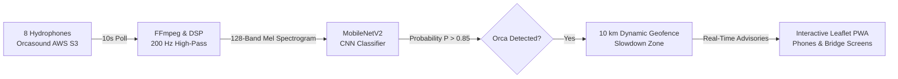

# OrcaSafe: Silence of the Sound

> **Real-Time Bioacoustic AI & Dynamic Maritime Slowdown System for Endangered Southern Resident Killer Whales**  
> *Developed by Shreyom Paul*

[](https://www.python.org/)
[](https://pytorch.org/)
[](https://fastapi.tiangolo.com/)
[](https://cloud.google.com/run)
[](https://opensource.org/licenses/MIT)

---

## Video Presentation & Tutorial

Watch the complete project overview, technical architecture walkthrough, and live app demonstration on YouTube:

[](https://youtu.be/4ec7q5aYNpM)

**Direct Link:** [https://youtu.be/4ec7q5aYNpM](https://youtu.be/4ec7q5aYNpM)

---

## The Problem: Acoustic Masking in the Salish Sea

The Southern Resident Killer Whale (SRKW) population is critically endangered, having dropped **24%** from a 1995 peak of 98 individuals to just **74 whales today**.

- **The Acoustic Wall**: Commercial cargo ships, oil tankers, and ferries generate continuous low-frequency cavitation noise that directly overlaps with the frequencies killer whales rely on for echolocation, navigation, and pod coordination.
- **Foraging Degradation**: Studies demonstrate that **every $1\text{ dB}$ increase in ship noise cuts an orca's odds of catching Chinook salmon prey by $12.5\%$**.
- **The Limitation of Current Programs**: Existing initiatives (like Quiet Sound and the ECHO Program) rely on voluntary, static seasonal slowdown zones. These cost ships time even when no whales are present, depressing compliance rates.

---

## The Solution: A Dynamic "School-Zone Light" on the Water

OrcaSafe acts like an automated, dynamic **school-zone light for maritime shipping**:
1. Continuously polls **8 live underwater hydrophone streams** across the Salish Sea every 10 seconds via AWS S3.
2. Filters out vessel propeller hum with a **$200\text{ Hz}$ high-pass filter** and transforms audio slices into **128-band Mel-spectrograms**.
3. Classifies orca calls in real time using a lightweight **MobileNetV2 neural network** ($< 0.8\text{s}$ latency, $92.6\%$ accuracy, $99.6\%$ precision at a $\tau = 0.85$ confidence threshold).
4. When whales are detected, establishes a **$10\text{ km}$ dynamic slowdown geofence** surrounding the hydrophone.
5. Alerts captains via an interactive Progressive Web App (PWA) to slow down to **$11\text{ knots}$**, **cutting underwater acoustic sound energy by roughly $90\%$** ($\sim 10\text{ dB}$ noise cut) and restoring $35\text{–}45\%$ of their foraging listening space.

---

## High-Level System Architecture



> **Deep Dive Documentation**: For mathematical derivations, sequence diagrams, and module explanations, see [**`ARCHITECTURE.md`**](file:///Users/rituparnapaul/SilenceOfSound/ARCHITECTURE.md).

---

## Technical Benchmarks

| Metric | Value | Technical Context |
| :--- | :--- | :--- |
| **Monitored Stations** | **8 Nodes** | Port Townsend, Bush Point, Orcasound Lab, Point Robinson, Sunset Bay, Andrews Bay, MAST Center, North SJC |
| **Audio Processing** | **200 Hz High-Pass** | 4th-order Butterworth filter attenuates ship rumble while preserving orca harmonic contours |
| **Spectrogram Input** | **128 Mel Bands** | Normalized $224 \times 224$ magma matrices with zero visual border artifacts |
| **Deep Learning Model** | **MobileNetV2** | Depthwise separable convolutions; 9.8 MB checkpoint size |
| **Inference Latency** | **< 0.8 seconds** | Over $450\text{ ms}$ faster than ResNet-18 benchmark on a single vCPU |
| **Model Accuracy** | **92.6%** | Evaluated across 15,000+ labeled 5-second spectrogram samples |
| **Model Precision** | **99.6%** | High precision at threshold $P > 0.85$ prevents mariner false alarm fatigue |
| **Slowdown Geofence** | **10 km Radius** | Dynamically triggered surrounding the detecting hydrophone node |
| **Slowdown Relief** | **~90% Sound Energy** | Slowing from $18\text{ kts}$ to $11\text{ kts}$ cuts vessel sound energy by $\sim 10\text{ dB}$ |
| **Compute Footprint** | **1 vCPU / 2 GB RAM** | Serverless Google Cloud Run container scaling down to zero when idle |

---

## Repository Structure

```
SilenceOfSound/
├── Code/                          # Production Web Application & API
│   ├── api.py                     # FastAPI backend orchestration & 30s TTL cache
│   ├── requirements.txt           # Production dependencies
│   └── static/                    # Responsive Progressive Web App frontend
│       ├── app.js                 # Leaflet.js mapping, GPS tracking, & alert debouncing
│       ├── index.html             # Bridge operator interface & vessel advisory panel
│       └── styles.css             # Glassmorphic dark theme
│
├── core/                          # Reusable AI, Physics, & Signal Processing Engines
│   ├── analytics.py               # Acoustic footprint & habitat recovery modeling
│   ├── config.py                  # Thresholds (0.85), baseline speeds (15 & 11 kts), & paths
│   ├── fetcher.py                 # S3 chunk fetcher & FFmpeg audio stream decoding
│   ├── maritime.py                # Vessel coordinate & navigation status mapping helpers
│   ├── models.py                  # MobileNetV2 architecture & checkpoint loader
│   └── spectrogram.py             # Standardized 200 Hz filtered Mel-spectrogram generator
│
├── data_processing/               # Offline Dataset Preparation & Physics Simulation
│   ├── AccousticFootPrint.py      # Transmission loss simulation & footprint reduction graph
│   ├── BuildSpectogram.py         # Batch Mel-spectrogram generator for training corpus
│   └── collectrainingData.py      # 5-second audio slice extraction & dataset labeling
│
├── models/                        # Serialized Weights
│   └── orca_safe_brain.pth        # Production PyTorch MobileNetV2 checkpoint (9.8 MB)
│
├── training_and_eval/             # Model Training & Evaluation Suite
│   ├── GenerateConfusionMatrix.py # Confusion matrix generator at threshold 0.85
│   ├── InferenceOrcaSafe.py       # Batch inference test script on sample directories
│   ├── InferenceOrcaSafeResnetvMobilenet.py # ResNet-18 vs MobileNetV2 latency & accuracy benchmark
│   ├── PrecisionRecall.py         # Precision-Recall curve evaluation across thresholds
│   └── TrainingPytorch.py         # Production MobileNetV2 training pipeline (recording-level split)
│
├── ARCHITECTURE.md                # Comprehensive technical architecture & source code guide
├── README.md                      # Project overview, tutorial video, & setup guide
├── Dockerfile                     # Cloud Run container definition (Python 3.10-slim + FFmpeg)
└── deploy.sh                      # Google Cloud Run deployment script
```

---

## Quickstart & Local Setup

### 1. Prerequisites
- **Python 3.10+**
- **FFmpeg** installed on your system:
  - macOS: `brew install ffmpeg`
  - Ubuntu/Debian: `sudo apt-get install ffmpeg`

### 2. Clone and Install Dependencies
```bash
git clone https://github.com/ShreyomP/SilenceOfSound.git
cd SilenceOfSound

pip install -r Code/requirements.txt
```

### 3. Launch the Local Development Server
```bash
uvicorn Code.api:app --reload --host 0.0.0.0 --port 8080
```

Open your browser and navigate to:
- **Localhost**: `http://localhost:8080`
- **Mobile Device (Same Wi-Fi)**: `http://<your-computer-local-ip>:8080`

---

## Running Model Training or Benchmarks

Train the production MobileNetV2 model with recording-level data leakage prevention:
```bash
python3 training_and_eval/TrainingPytorch.py
```

Run the MobileNetV2 vs ResNet-18 latency and throughput benchmark:
```bash
python3 training_and_eval/InferenceOrcaSafeResnetvMobilenet.py
```

---

## Cloud Deployment (Google Cloud Run)

OrcaSafe is containerized with FFmpeg and Python dependencies, ready for serverless deployment:

```bash
chmod +x deploy.sh
./deploy.sh
```

Or deploy directly with Docker:
```bash
docker build -t orcasafe-api .
docker run -p 8080:8080 orcasafe-api
```

---

## Author & Acknowledgments

- **Creator**: [Shreyom Paul](https://github.com/ShreyomP)
- **Initiatives**: Created for the **Congressional App Challenge**
- **Data & Research Partners**:
  - [Orcasound](https://www.orcasound.net/) for open-access hydrophone livestreams and bioacoustic datasets.
  - [Quiet Sound](https://www.quietsound.org/) & [Port of Vancouver ECHO Program](https://www.portvancouver.com/environmental-protection-at-the-port-of-vancouver/climate-action-and-air-quality/echo-program/) for vessel slowdown acoustic research and guidelines.

---

## License

This project is licensed under the MIT License — see the [LICENSE](LICENSE) file for details.
